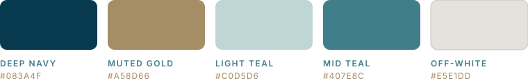

<p align="center">
  <picture>
    <source media="(prefers-color-scheme: dark)" srcset=".github/assets/logo-dark.png">
    
  </picture>
</p>

<p align="center"><b>Web Dashboard</b> &nbsp;|&nbsp; the whole port on one screen</p>
<p align="center"><i>Smarter coordination. Stronger ports.</i></p>

<p align="center">
  
  
</p>

<p align="center">
  
  
  
  
  
  
</p>


## What lives here

This is the dashboard where port authority staff, terminal planners, marine safety officers and administrators spend their day. It runs inside the port's own network, talks to the Laravel Port API over HTTPS and stays live through **Server-Sent Events**, so a recommendation shows up the moment it's ready, without anyone hitting refresh.

## What you can do with it

- **Berthing requests.** Submit, review, approve and follow each request through its lifecycle.
- **Entry windows.** See the safe windows and blocked periods from AI Part 1, then confirm one. This is the first human checkpoint.
- **Recommendations.** Compare the ranked berth, tug and pilot options side by side, read why each was chosen, then confirm the plan or override any part of it. This is the second checkpoint.
- **BAPLIE and the yard.** Upload stowage files and review yard placement for the Container Terminal.
- **Tracking.** Watch plans being carried out and catch deviations as they happen.
- **People and access.** Users, roles and devices, with each terminal's data kept private from the others.
- **License status.** A clear banner whenever the port is in `SETUP` or `READ_ONLY` mode.

## Look and feel

<p align="center">
  
</p>

| Token | Hex | Feels like |
|---|---|---|
| Deep Navy | `#083A4F` | trust, stability |
| Muted Gold | `#A58D66` | value, progress |
| Light Teal | `#C0D5D6` | clarity, balance |
| Mid Teal | `#407E8C` | innovation, growth |
| Off-White | `#E5E1DD` | simplicity, focus |

Type is set in **Montserrat**, with **Inter** for dense data. Shapes are clean and geometric, with the wave motif used here and there and open, round-jointed icons. Use the identity, but please don't redraw the logo.

## Stack

| Area | Technology |
|---|---|
| Framework | Vue.js |
| Talking to the server | REST over HTTPS, Server-Sent Events |
| Backend | [ATLANTECH Port API](https://github.com/Atlantech-project/project-backend) |

## Getting started

```bash
git clone https://github.com/Atlantech-project/project-frontend.git
cd project-frontend
```

Setup steps will be added here once the project is scaffolded.

## Neighbours

[PortHub](https://github.com/Atlantech-project/PortHub) &middot;
[project-backend](https://github.com/Atlantech-project/project-backend) &middot;
[project-ai](https://github.com/Atlantech-project/project-ai) &middot;
[project-mobile](https://github.com/Atlantech-project/project-mobile)

## Crew

**Mostafa Safy Mostafa Soliman**, Frontend Engineer<br>
**Mostafa El-Hassanen El-Hassanen El-Sharawey**, Frontend Engineer<br>
**Menna-Allah Maged Nabil Mohamed**, UI/UX Designer


<p align="center">
  <picture>
    <source media="(prefers-color-scheme: dark)" srcset=".github/assets/symbol-dark.png">
    
  </picture>
</p>

<p align="center">
  <sub>ATLANTECH, Intelligent Port Operations &middot; Mansoura University &middot; Graduation Project 2026</sub>
</p>
